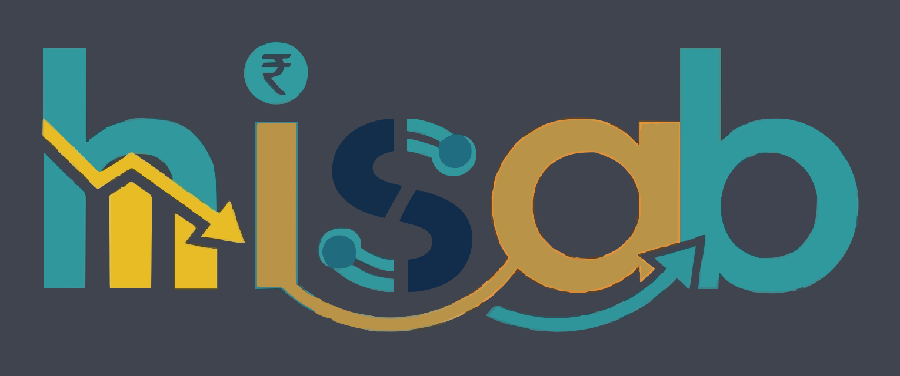
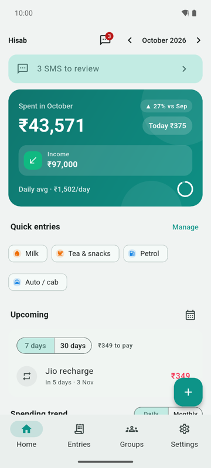
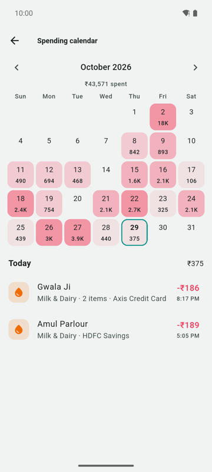
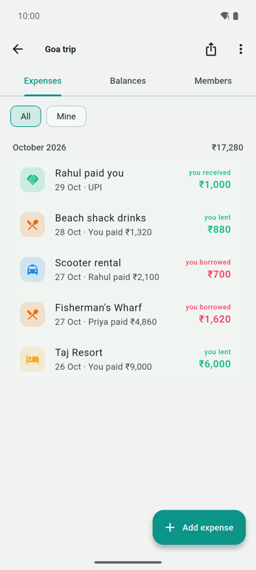
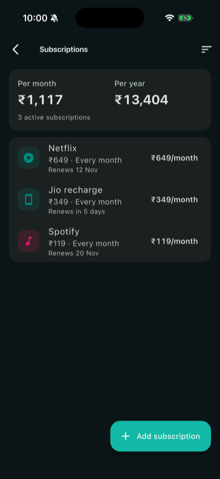

<p align="center">
  
</p>

<p align="center">
  <b>Free, open-source expense tracker for Android and iOS.</b><br>
  Multi-item entries, bank SMS auto-tracking and Splitwise-style groups. No ads, no trial, no account.
</p>

<p align="center">
  
  
  
  
  
  <br>
  
  
  
  <a href="LICENSE"></a>
</p>

<p align="center"><sub>Tests and coverage measured on 2026-10-29 with <code>flutter test --coverage</code> (line coverage of <code>lib/</code>, generated <code>*.g.dart</code> and <code>lib/l10n/generated</code> excluded).</sub></p>

## Screenshots

<table>
  <tr>
    <td align="center"><br><sub>Dashboard</sub></td>
    <td align="center"><br><sub>Spending calendar</sub></td>
    <td align="center"><br><sub>Group expenses</sub></td>
    <td align="center"><br><sub>Subscriptions (dark, iOS)</sub></td>
  </tr>
</table>

<p align="center"><b><a href="docs/SCREENSHOTS.md">More screenshots: all 13 screens on Android and iOS →</a></b></p>

<sub>Screens from an Android emulator and an iPhone simulator with made-up demo data.</sub>

## Features

### ✍️ Entries
- 🧾 **Multi-item entries**: one entry can hold several items with quantity, unit and price (buffalo milk 2 L, paneer 0.2 kg). Hisab remembers items per category and suggests them next time.
- 🧮 **Built-in calculator** keypad for the amount, so 450 + 120 is one step.
- 🔁 **Repeat** any entry daily, weekly, monthly or yearly straight from the editor.
- 🔎 **Search and filters** across payee, note, item and category, with expense / income / transfer and project filters.

### 📩 Bank SMS auto-tracking
- 🏦 **Reads bank alerts on Android** (opt-in, on-device): detects debits, credits, card spends and balances from 70+ Indian bank sender IDs.
- ✅ **Review inbox** for messages that aren't clear enough to add on their own: add, edit or ignore each one. Auto-add for confident matches, with undo.
- 📋 **Paste or share an SMS** on iOS and Android, or forward alerts with an iOS Shortcut.

### 👥 Groups (Splitwise-style)
- ➗ **Split any way**: equally, exact amounts, percentages, shares or with adjustments, and with multiple payers.
- 🤝 **Simplified settle-up**: fewest transfers to square up, remind by WhatsApp or SMS, record full or partial payments, pay by UPI link.
- 📊 **Group totals**: what the group spent, your share, what you paid and how your balance changed.
- 🕘 **Activity log** of every add, edit and delete, with restore for deleted expenses and groups; archive old groups; export a group to CSV.

### 💳 Accounts & cards
- 🏛️ **Bank accounts, credit cards and wallets** with balances that follow your entries and transfers.
- 🗂️ **Grouped account picker** so the right account is one tap away.

### 🎯 Budgets, categories & projects
- 📉 **Budgets** overall or per category, with a pace marker, what's left for the days remaining and, for the overall budget, a safe-to-spend amount per day.
- 📅 **Salary-month cycle**: start your month on payday.
- 🏷️ **18 expense groups and 100+ subcategories**, plus income and transfer categories, all editable, and **category packs** you can add in a tap.
- 🏗️ **Projects** for a car, construction, renovation, trip or wedding, with templates and custom fields to track their total cost.

### 🔄 Recurring & subscriptions
- 🗓️ **Recurring rules** for rent, SIP, EMI or salary: set once and Hisab posts them on the day (or asks you first), catching up on missed days.
- 📺 **Subscriptions** with monthly and yearly totals and renewal dates.

### 📈 Dashboard & reports
- 💰 **This month at a glance**: what you spent and earned, the daily average and the change against last month. No verdicts: budgets live in their own card.
- 📈 **Spending trend** (daily or monthly) and a **category donut** with shares.
- 🧩 Cards for budgets, accounts, groups, projects and recent entries.

### 🌍 Currency
- 💱 **Currency picker** on first launch and in Settings, with 150+ currencies, and amounts in Indian digit grouping (12,34,567).

### 🔐 Backup & restore
- 🔒 **Encrypted backup** with AES-256-GCM, protected by a passphrase you choose (PBKDF2 key). Restore it on any phone, Android or iPhone.
- ☁️ **Optional Google Drive backup** (Android): one encrypted copy in your own Drive's hidden app folder, restored on a new phone. Hisab can only see its own file, and there is no Hisab server.

### 🎨 Look & language
- 🌗 **Light and dark theme**, or follow the system.
- 🇮🇳 **English and Hindi**, switchable in Settings. Adding a language is one ARB file (see [docs/LOCALIZATION.md](docs/LOCALIZATION.md)).

## Coming soon

Work in progress and ideas live on the [roadmap discussion (#7)](https://github.com/RagedPanda/hisab/discussions/7). Next up:
- Split a group expense by item
- Due-date, document and renewal reminders with notifications
- Credit card statement and due days with automatic reminders
- Upcoming payments card and due calendar
- Salary-day rule
- Recurring group expenses and settle-up reminders
- Encrypted cloud sync

## Getting started

You need Flutter 3.47 (Dart 3.13). For Android, the Android SDK; for iOS, a Mac with Xcode and CocoaPods.

```sh
git clone https://github.com/RagedPanda/hisab.git
cd hisab
flutter pub get
dart run build_runner build --delete-conflicting-outputs   # Drift code generation
flutter test
```

**Android** (7.0 / API 24 or newer):
```sh
flutter run -d <android-device-id>
flutter build apk --release
```

**iOS** (15.0 or newer):
```sh
flutter run -d <ios-device-or-simulator-id>
flutter build ios --release
```

Tip: a debug build started with `--dart-define=HISAB_SEED_ENTRIES=300` fills a fresh install with demo data (ignored in release builds).

## Tech stack

| Layer | Choice |
|---|---|
| UI | [Flutter](https://flutter.dev) 3.47, Material 3, light and dark themes |
| State | [Riverpod](https://riverpod.dev) 3 |
| Navigation | [go_router](https://pub.dev/packages/go_router) with stateful bottom tabs and `hisab://` deep links |
| Storage | [Drift](https://drift.simonbinder.eu) (SQLite) with typed schema and migrations |
| Charts | [fl_chart](https://pub.dev/packages/fl_chart) |
| Crypto | [cryptography](https://pub.dev/packages/cryptography) (AES-256-GCM, PBKDF2) |
| Localization | Flutter gen-l10n with ARB files (English, Hindi) |

More in [docs/PLAN.md](docs/PLAN.md): architecture, feature matrix and the sync design.

## Privacy

- **Your data stays on your device.** Hisab has no account, no server and no analytics.
- **SMS is read on-device.** Bank SMS reading is opt-in, Android only, and messages are parsed locally; nothing is uploaded.
- **Backups are yours.** An exported backup is encrypted with your passphrase before it leaves the app.

Every permission, per platform, is listed in [docs/PERMISSIONS.md](docs/PERMISSIONS.md).

## Docs

- [docs/PLAN.md](docs/PLAN.md): architecture, feature matrix, sync design.
- [docs/PERMISSIONS.md](docs/PERMISSIONS.md): every permission per platform, store declaration text, reference apps.
- [docs/LOCALIZATION.md](docs/LOCALIZATION.md): English and Hindi today; a new language is one ARB file plus a category-name map.
- [docs/REFERENCE_APPS.md](docs/REFERENCE_APPS.md): what FinArt, Splitwise, Money Manager, Monefy, Cashew and PennyWise taught us.

## Contributing

Issues and pull requests are welcome.
- Found a bug? [Open an issue](https://github.com/RagedPanda/hisab/issues).
- Have an idea? Add it to the [roadmap discussion (#7)](https://github.com/RagedPanda/hisab/discussions/7).

Before opening a PR, run `flutter analyze` and `flutter test`, and add new user-facing strings to both ARB files (`lib/l10n/app_en.arb`, `lib/l10n/app_hi.arb`) rather than hardcoding them (see [docs/LOCALIZATION.md](docs/LOCALIZATION.md)).

## License

[MIT](LICENSE) © 2026 Ankur Dubey
