# Screenshots

Every screen of Hisab as it looks on Android and on iOS, shot over the same made-up demo data. Use **‹ Previous** and **Next ›** under each screen to step through them, or jump from the list below.

[← Back to README](../README.md)

## Contents

1. [Dashboard](#dashboard)
2. [Entries](#entries)
3. [Multi-item entry](#multi-item-entry)
4. [Group expenses](#group-expenses)
5. [Group settle-up](#group-settle-up)
6. [Bank SMS review](#bank-sms-review)
7. [Subscriptions (dark)](#subscriptions-dark)
8. [Budgets (Hindi)](#budgets-hindi)
9. [Spending calendar](#spending-calendar)
10. [Due calendar](#due-calendar)
11. [New entry](#new-entry)
12. [Quick entries](#quick-entries)
13. [Spending calendar (dark)](#spending-calendar-dark)

## Dashboard

The month's spend and income, SMS waiting for review, quick entries and upcoming dues at a glance.

<table>
  <tr><th>Android</th><th>iOS</th></tr>
  <tr>
    <td align="center">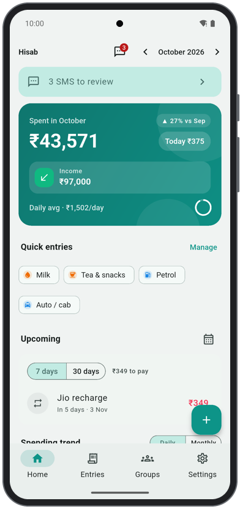</td>
    <td align="center">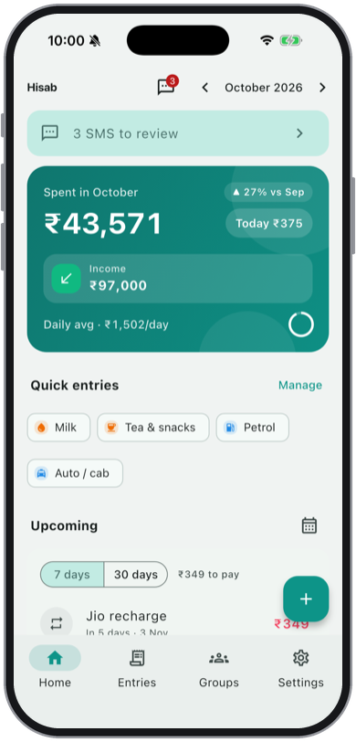</td>
  </tr>
</table>

‹ Previous · [Contents](#contents) · [Next: Entries ›](#entries)

## Entries

Every entry with search, filters and the month switcher; the calendar button opens the spending calendar.

<table>
  <tr><th>Android</th><th>iOS</th></tr>
  <tr>
    <td align="center">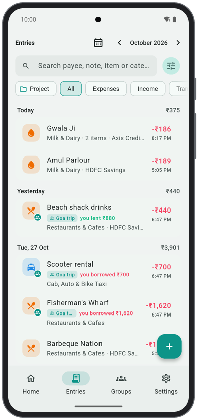</td>
    <td align="center">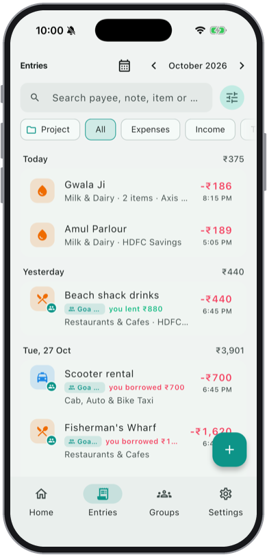</td>
  </tr>
</table>

[‹ Previous: Dashboard](#dashboard) · [Contents](#contents) · [Next: Multi-item entry ›](#multi-item-entry)

## Multi-item entry

One bill split into items (buffalo milk, paneer), each with its own quantity, unit and price.

<table>
  <tr><th>Android</th><th>iOS</th></tr>
  <tr>
    <td align="center">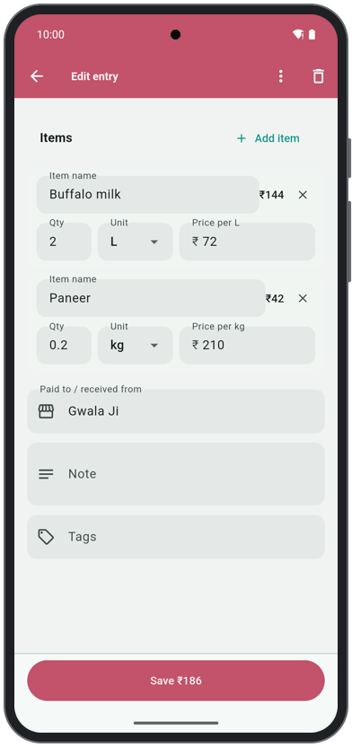</td>
    <td align="center">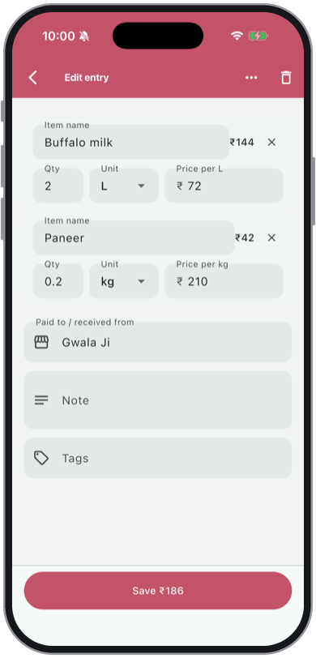</td>
  </tr>
</table>

[‹ Previous: Entries](#entries) · [Contents](#contents) · [Next: Group expenses ›](#group-expenses)

## Group expenses

A shared trip: who paid what, and how each expense is split.

<table>
  <tr><th>Android</th><th>iOS</th></tr>
  <tr>
    <td align="center">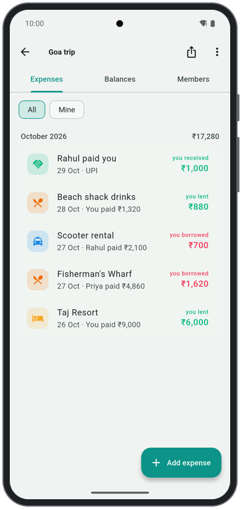</td>
    <td align="center">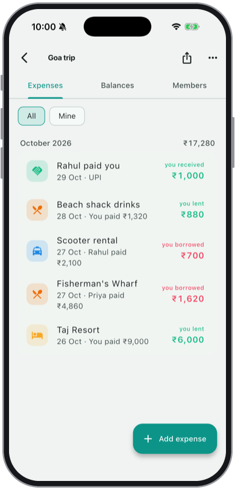</td>
  </tr>
</table>

[‹ Previous: Multi-item entry](#multi-item-entry) · [Contents](#contents) · [Next: Group settle-up ›](#group-settle-up)

## Group settle-up

Totals and balances per member, with the fewest payments to settle up.

<table>
  <tr><th>Android</th><th>iOS</th></tr>
  <tr>
    <td align="center">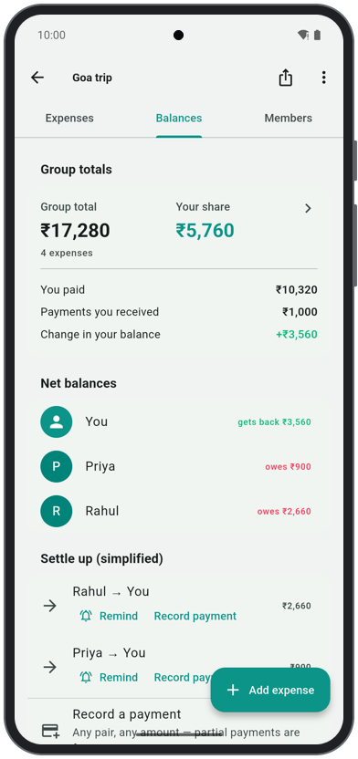</td>
    <td align="center">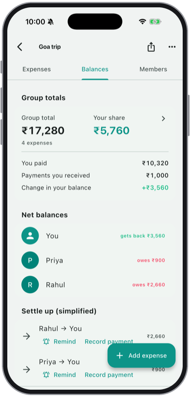</td>
  </tr>
</table>

[‹ Previous: Group expenses](#group-expenses) · [Contents](#contents) · [Next: Bank SMS review ›](#bank-sms-review)

## Bank SMS review

Transactions read from bank SMS wait here to be confirmed or dismissed.

<table>
  <tr><th>Android</th><th>iOS</th></tr>
  <tr>
    <td align="center">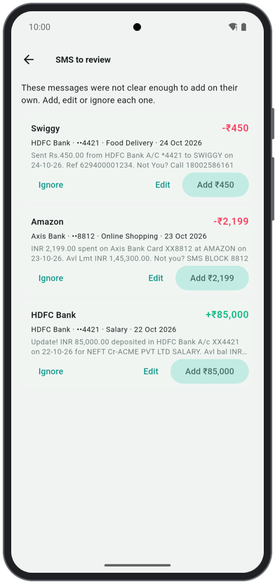</td>
    <td align="center">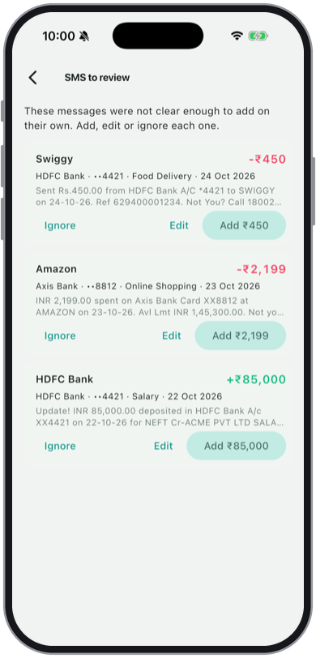</td>
  </tr>
</table>

[‹ Previous: Group settle-up](#group-settle-up) · [Contents](#contents) · [Next: Subscriptions (dark) ›](#subscriptions-dark)

## Subscriptions (dark)

Recurring payments with their next due date, in the dark theme.

<table>
  <tr><th>Android</th><th>iOS</th></tr>
  <tr>
    <td align="center">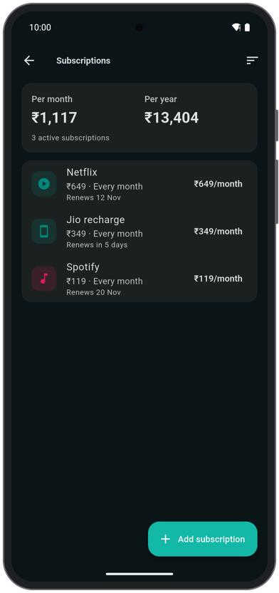</td>
    <td align="center">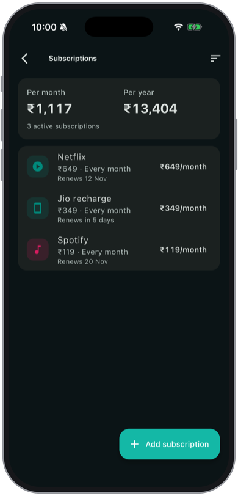</td>
  </tr>
</table>

[‹ Previous: Bank SMS review](#bank-sms-review) · [Contents](#contents) · [Next: Budgets (Hindi) ›](#budgets-hindi)

## Budgets (Hindi)

Category budgets, accounts and recent entries with the app in Hindi.

<table>
  <tr><th>Android</th><th>iOS</th></tr>
  <tr>
    <td align="center">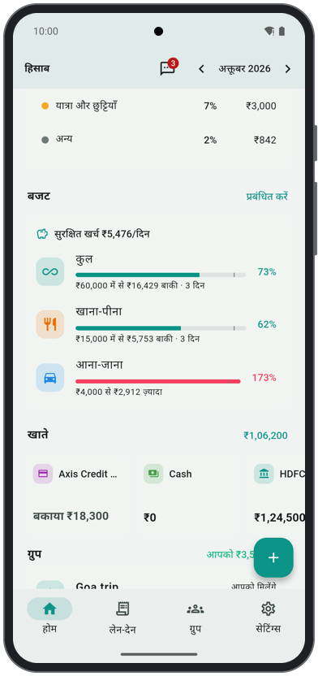</td>
    <td align="center">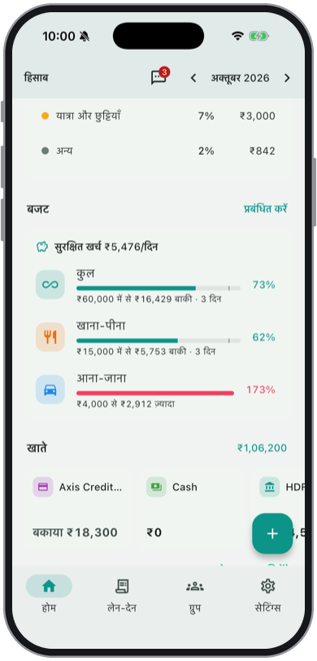</td>
  </tr>
</table>

[‹ Previous: Subscriptions (dark)](#subscriptions-dark) · [Contents](#contents) · [Next: Spending calendar ›](#spending-calendar)

## Spending calendar

Each day shaded by what was spent; tap a day to list its entries.

<table>
  <tr><th>Android</th><th>iOS</th></tr>
  <tr>
    <td align="center">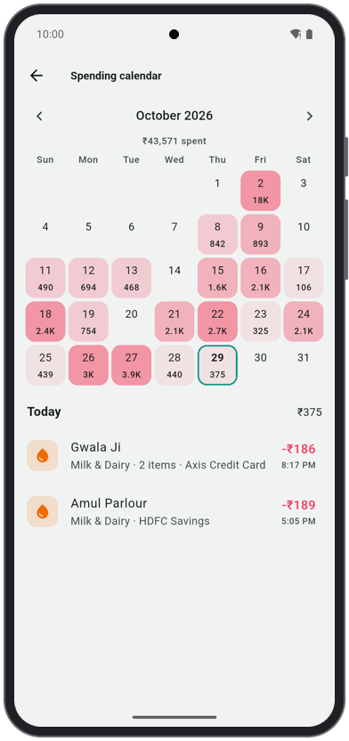</td>
    <td align="center">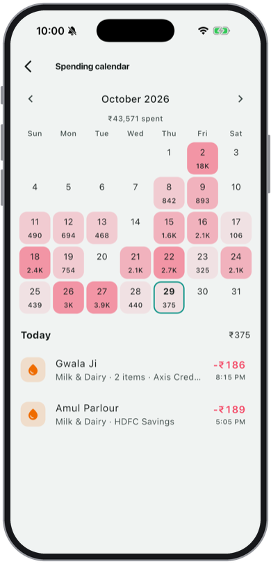</td>
  </tr>
</table>

[‹ Previous: Budgets (Hindi)](#budgets-hindi) · [Contents](#contents) · [Next: Due calendar ›](#due-calendar)

## Due calendar

Upcoming bills and subscriptions laid out by due date.

<table>
  <tr><th>Android</th><th>iOS</th></tr>
  <tr>
    <td align="center">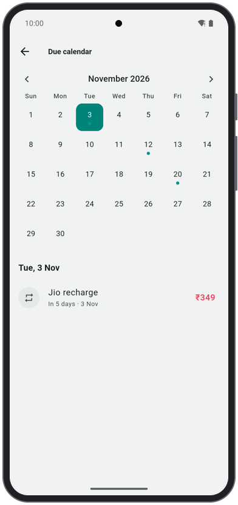</td>
    <td align="center">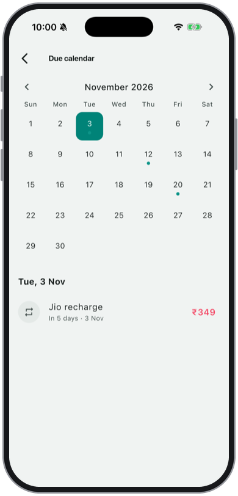</td>
  </tr>
</table>

[‹ Previous: Spending calendar](#spending-calendar) · [Contents](#contents) · [Next: New entry ›](#new-entry)

## New entry

Adding an expense, here prefilled from a quick entry.

<table>
  <tr><th>Android</th><th>iOS</th></tr>
  <tr>
    <td align="center">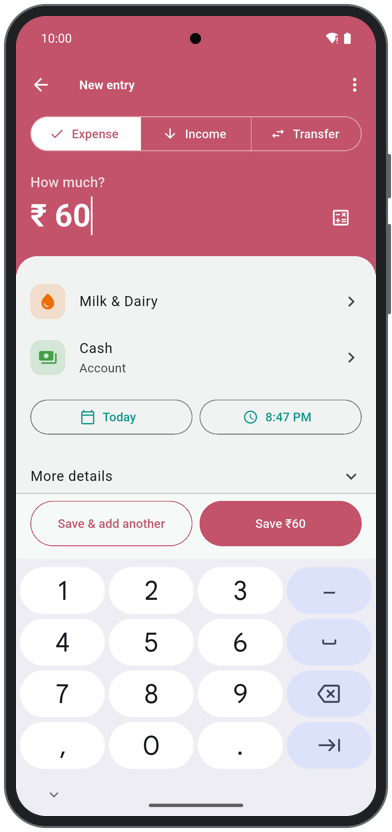</td>
    <td align="center">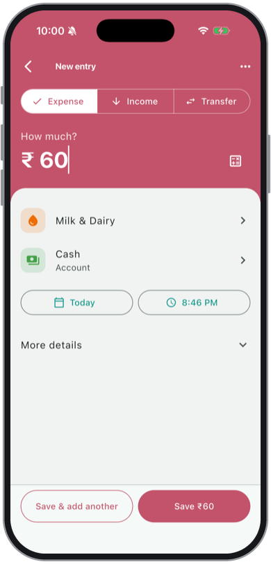</td>
  </tr>
</table>

[‹ Previous: Due calendar](#due-calendar) · [Contents](#contents) · [Next: Quick entries ›](#quick-entries)

## Quick entries

One-tap templates for things bought often.

<table>
  <tr><th>Android</th><th>iOS</th></tr>
  <tr>
    <td align="center">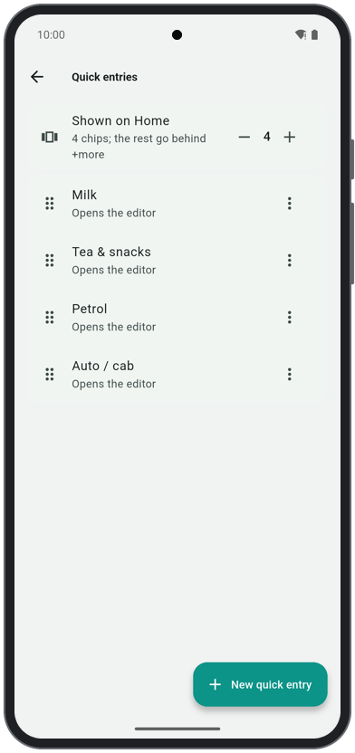</td>
    <td align="center">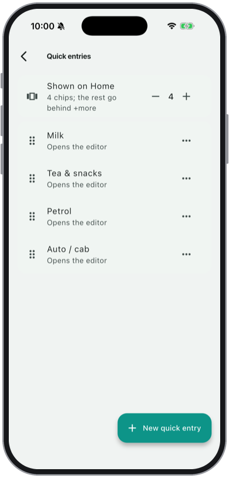</td>
  </tr>
</table>

[‹ Previous: New entry](#new-entry) · [Contents](#contents) · [Next: Spending calendar (dark) ›](#spending-calendar-dark)

## Spending calendar (dark)

The spending calendar in the dark theme.

<table>
  <tr><th>Android</th><th>iOS</th></tr>
  <tr>
    <td align="center">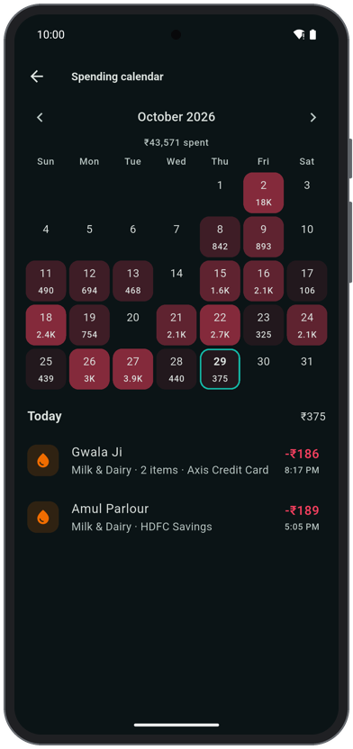</td>
    <td align="center">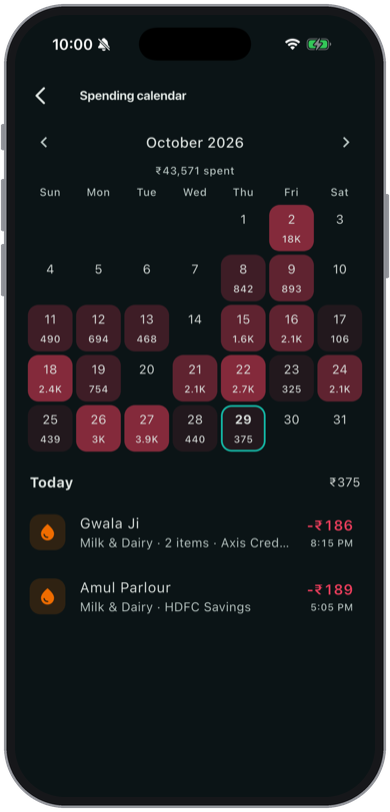</td>
  </tr>
</table>

[‹ Previous: Quick entries](#quick-entries) · [Contents](#contents) · Next ›

Shot with <code>tool/readme_screenshots.sh</code> on an Android emulator and an iPhone simulator.
